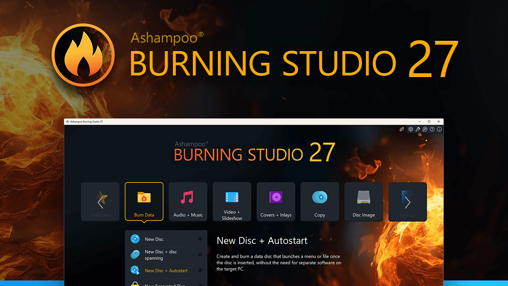

# Ashampoo Burning Studio for Discs and Media

Ashampoo Burning Studio 27 combines disc writing, media projects, and backup tools for Windows.
Ashampoo Burning Studio supports workflows for data, music, video, and disc images.
An ashampoo burning studio 27 review should distinguish the paid suite from the separate FREE edition.
Choose an ashampoo dvd burner workflow according to whether the result should hold files or play as a video disc.
For an ashampoo cd burner project, decide between an audio CD and a disc containing music files.

[](https://ashampoo-burning-studio-27.github.io/Ashampoo-Burning-Studio/)

This independent overview accompanies selected K3b source files.
K3b is a separate open-source disc authoring application.
The supplied files are reference material, not Ashampoo Burning Studio source code.
The snapshot lacks parts of the K3b application and does not establish a complete build environment.

## Features

Select the project type by the device or recovery task that will use the finished disc.
Copying media files onto a data disc does not automatically create a video DVD or an audio CD.

| Intended result | Project type | Review before writing |
| --- | --- | --- |
| Store documents and folders | Data disc | File list, capacity, and readable filenames |
| Play music in a conventional CD player | Audio CD | Track order, duration, and playback gaps |
| Store compressed music files | Music data disc | Formats supported by the destination player |
| Play a movie in a DVD player | Authored video DVD | Navigation, playback format, and menu behavior |
| Preserve a disc as a file | Disc image | Image format and associated files |
| Keep protected backup archives | Backup project | Password availability and recovery procedure |

The suite includes tools beyond basic file writing.
Use the product documentation to check which functions belong to the installed edition.
Keep a saved project distinct from the files or disc image used to produce the final result.

- Confirm the recorder and inserted medium.
- Review the total project size.
- Check the order of tracks or chapters.
- Keep source files available until the result is checked.
- Record where saved projects and backup archives are stored.


## Data CD/DVD

A data project stores files and folders for later use.
Organize the file list so the intended reader can locate the important content.
Check the available capacity against the full selection rather than a single folder.

For a backup project, keep the recovery requirements visible.
Password protection requires access to the password when restoring.
When an archive spans several discs, preserve the complete numbered set.

A useful verification includes reading representative files after writing.
For important archives, also exercise the documented restore procedure.
A successful writing message and a successful recovery exercise answer different questions.

The supplied K3b device references illustrate separate parts of optical media handling:

- [k3bdevice.cpp](libk3bdevice/k3bdevice.cpp) contains device operations.
- [k3bdevicemanager.cpp](libk3bdevice/k3bdevicemanager.cpp) manages detected devices.
- [k3bdiskinfo.cpp](libk3bdevice/k3bdiskinfo.cpp) provides disc information support.

These files describe K3b behavior and do not define Ashampoo's recording engine.

## Audio CD

An audio CD and an MP3 data disc have different playback requirements.
Choose the format supported by the player that will receive the disc.
Review track order and transitions by listening to the project.

Ripping takes audio from a disc and saves it as files.
Encoding determines how those files represent the audio.
Metadata and cover information help organize a music collection but should still be reviewed.

- Check artist, album, and track names.
- Choose a suitable output format for the intended use.
- Review volume adjustments by listening.
- Keep a clear distinction between original and converted files.
- Test the finished disc in the intended player.

K3b's decoder references include:

- [k3bwavedecoder.cpp](plugins/decoder/wave/k3bwavedecoder.cpp) handles WAV decoding.
- [k3bflacdecoder.cpp](plugins/decoder/flac/k3bflacdecoder.cpp) handles FLAC decoding.
- [k3bffmpegdecoder.cpp](plugins/decoder/ffmpeg/k3bffmpegdecoder.cpp) connects to FFmpeg-based decoding.

Its encoder and metadata references include:

- [k3blameencoder.cpp](plugins/encoder/lame/k3blameencoder.cpp) implements LAME encoding integration.
- [k3boggvorbisencoder.cpp](plugins/encoder/ogg/k3boggvorbisencoder.cpp) implements Ogg Vorbis encoding.
- [k3baudiometainforenamerplugin.cpp](plugins/project/audiometainforenamer/k3baudiometainforenamerplugin.cpp) uses audio metadata for project naming.

These are independent implementations and do not establish the codecs bundled with Burning Studio.

## Audio CD support details

Basic properties of source audio can be checked outside the authoring application.
This Python example reads an existing uncompressed PCM WAV file.
It reports the sample rate, channel count, sample width, and duration.

```python
import wave

with wave.open("track.wav", "rb") as track:
    print("Sample rate:", track.getframerate())
    print("Channels:", track.getnchannels())
    print("Sample width in bytes:", track.getsampwidth())
    print("Seconds:", track.getnframes() / track.getframerate())
```

The example uses Python's standard wave module, not a Burning Studio scripting API.
It does not convert audio or write a disc.
Support for other WAV encodings depends on the Python version.

Additional optical audio structures can be inspected in:

- [k3btoc.cpp](libk3bdevice/k3btoc.cpp), which implements table-of-contents support.
- [k3btrack.cpp](libk3bdevice/k3btrack.cpp), which implements track information.
- [k3bcdtext.cpp](libk3bdevice/k3bcdtext.cpp), which implements CD-TEXT handling.

## Image Management

Disc images can preserve a prepared layout for later writing.
Burning Studio documents support for ISO, CUE/BIN, and its ASHDISC format.
Keep all files associated with a multi-file image together.

Select the image-writing workflow when the intention is to reproduce the image's contents on disc.
Adding an ISO file to a data compilation instead stores that ISO as a regular file.
Review the selected operation before starting.

Video authoring also differs from copying a video file.
An authored DVD includes a structure intended for compatible DVD players.
Check navigation and playback on the target device.

The supplied [videodvd.cpp](kioworkers/videodvd/videodvd.cpp) belongs to K3b's Video DVD KIO worker.
It is not Ashampoo's video authoring implementation.



## Supported Devices

The recorder must support the selected media type.
A device that reads a disc type may not be able to write it.
Check the drive model, medium, and application version when investigating a failure.

The following PowerShell command lists optical drive information reported by Windows.
It uses the Windows CIM interface and does not invoke Burning Studio.

```powershell
Get-CimInstance -ClassName Win32_CDROMDrive |
    Select-Object Name, Drive, MediaLoaded, Status |
    Format-Table -AutoSize
```

A reported device status does not prove compatibility with every writable medium.
Confirm the recorder's capabilities and the result shown by the authoring application.

## Requirements

Use Ashampoo's requirements for the installed product version.
K3b dependency settings belong to a different application and operating system environment.
They cannot establish Burning Studio compatibility.

The supplied [CMakeLists.txt](CMakeLists.txt) declares K3b's build configuration.
Other application directories and dependencies referenced by the project are absent.
The selected files support source inspection rather than a complete application build.

Two supplied K3b tests provide additional development references:

- [k3bdataprojectmodeltest.cpp](tests/k3bdataprojectmodeltest.cpp) tests data project model behavior.
- [k3bdefaultexternalprogramstest.cpp](tests/k3bdefaultexternalprogramstest.cpp) tests helper logic for external program definitions.

Those tests do not validate Burning Studio or a disc written with it.

## Bugs & Feedback

A useful report identifies the project type and the operation that failed.
Separate source file problems from recorder detection and physical media issues.
Include the exact message and the last completed step.

- State the Burning Studio version and Windows build.
- Identify the recorder model and media type.
- Describe whether the task involves data, audio, video, an image, or backup.
- Record whether the problem occurs before writing or during writing.
- Keep reports about K3b reference code separate from Ashampoo support requests.

## Related Search Terms

Ashampoo Burning Studio 27, Ashampoo Burning Studio, ashampoo burning studio 27 review, ashampoo dvd burner, ashampoo cd burner, disc-burning, cd-audio, cdrom, dvd, blu-ray, disk-image, backup, multimedia, windows, optical-disc
